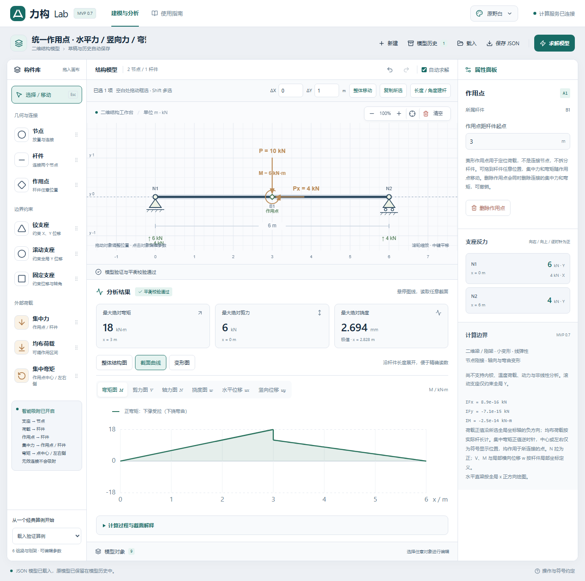
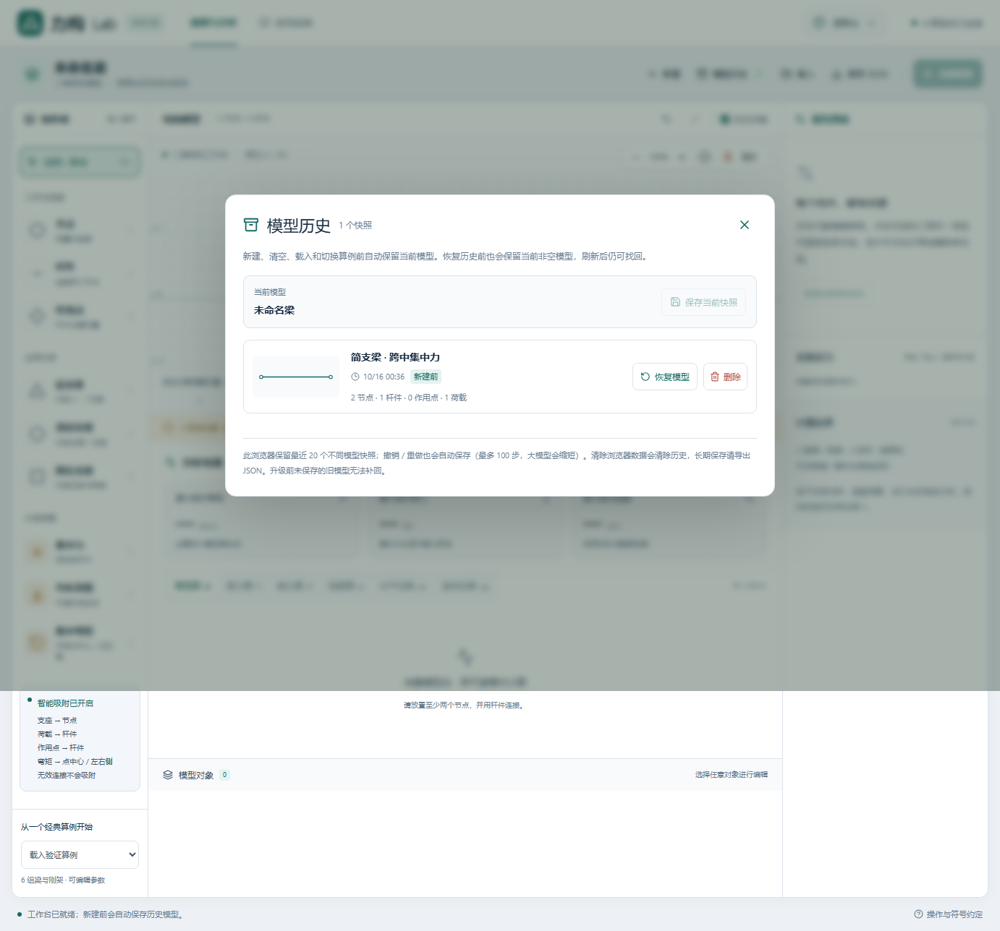

# 力构 Lab 0.7

可运行的中文可视化二维梁 / 刚架建模 MVP。React + TypeScript + Vite + React Konva + Tailwind CSS 前端，Python + FastAPI + NumPy / SciPy 真实求解后端。计算不依赖外部 API 或 AI；断开计算服务时明确报错，不展示虚构结果。

0.7 完成四项升级：集中力与弯矩共用作用点；CAD 式框选、多选、复制、整体移动和长度 / 角度建杆；按真实 ux / uy 绘制可放大的变形轮廓；点击支座或截面查看平衡贡献、内力公式及两侧截面值。

旧版完整保存于 GitHub 私有仓库 `l94649884-cmyk/01`，`01` 标签指向提交 `ff59c02`。新功能位于 `feature/workbench-upgrade` 分支。

0.6 新增独立“作用点”：在杆件任意位置放置菱形标记，无需建立连接节点或拆杆。集中弯矩可吸附到作用点中心、左侧或右侧；三种显示位置均作用于同一点。作用点可拖动、精确编辑位置、独立删除，并支持撤销、历史和 JSON 保存。原有节点弯矩继续兼容。

同时修正固定支座符号朝向：左右端分别朝外，竖杆上下端与斜杆符号自动旋转。方向根据相连杆件实时计算，节点或杆件移动后自动更新。示例：[左右固定支座](docs/fixed-supports.png)、[竖柱固定支座](docs/fixed-support-vertical.png)。

0.4 新增模型历史（最近 20 个不同快照）、刷新后保留撤销 / 重做，以及新荷载按杆件朝向自动推荐 X / Y 方向。0.4.2 将画布右上角按钮明确改为“清空模型”，删除全部节点、杆件、支座与荷载；清空前保存历史，可撤销。历史快照新增逐条删除，刷新后保持删除结果。滚轮缩放与中键平移可继续使用。新建、清空、导入、切换算例与恢复历史前会保存当前非空模型；存储失败时中止切换，保留当前内容。

0.3 已实现局部均布荷载区间编辑与端点拖动、沿结构几何方向显示的整体内力图，并重新设计工作台和带预览的主题面板。宽屏（≥1600 px）并排显示建模与结果；窄屏保留上下布局。原有二维刚架计算、独立支座删除与五套主题继续可用。



## 快速启动（Windows）

需要 Node.js 22.12+（建议 24 LTS）和 Python 3.12+（本机验证为 3.12）。首次安装：

```powershell
cd <解压后的 ligou-lab 目录>
powershell -ExecutionPolicy Bypass -File .\Setup.ps1
powershell -ExecutionPolicy Bypass -File .\Start.ps1
```

打开 **http://127.0.0.1:8000**。生产构建由 FastAPI 同源提供，只需一个服务。停止时在终端按 Ctrl+C。本次交付目录已安装依赖并构建，可直接运行 `Start.ps1`。ZIP 不包含虚拟环境与 node_modules，换机器或移动目录后请重新运行 Setup。

如 `python` 指向 Windows 应用商店占位程序，指定真实 Python：

```powershell
powershell -ExecutionPolicy Bypass -File .\Setup.ps1 -Python "C:\path\to\python.exe"
```

如端口占用：`powershell -ExecutionPolicy Bypass -File .\Start.ps1 -Port 8001`。

需要后台运行时使用 `powershell -ExecutionPolicy Bypass -File .\Start.ps1 -Background`，关闭使用 `powershell -ExecutionPolicy Bypass -File .\Stop.ps1`。日志保存于 `.runtime/`；停止脚本检查进程身份，避免误停其他程序。

## 开发启动

终端一（项目根目录）：

```powershell
.\.venv\Scripts\python.exe -m uvicorn app.main:app --app-dir backend --host 127.0.0.1 --port 8000 --reload
```

终端二：

```powershell
cd frontend
npm ci
npm run dev
```

打开 http://127.0.0.1:5173；Vite 将 `/api` 转发至本机 8000。默认只监听本机，不需设置 CORS。API 文档位于 http://127.0.0.1:8000/docs 。

macOS / Linux：`python3 -m venv .venv`，使用 `.venv/bin/python -m pip install -r backend/requirements-lock.txt`，在 frontend 执行 `npm ci && npm run build`，回到根目录执行 `.venv/bin/python -m uvicorn app.main:app --app-dir backend --host 127.0.0.1 --port 8000`。跨平台流程已提供，但本次实际测试平台为 Windows。

## 怎么用

1. 首次打开自动载入 **6 m 简支梁跨中 10 kN**；左侧可以切换六组验证算例，包括竖柱、斜向悬臂和 L 形刚架。
2. 点击“新建”；将节点拖到画布，或选中节点工具后点击放置。坐标按 0.25 m 网格吸附，靠近已有节点的水平线或竖直线时对齐。
3. 杆件工具依次点击两个节点，可连接水平、竖向或斜向杆件。也可将杆件工具拖到起点，再点击终点。不能连接同一节点、跨过杆件路径上的中间节点、重复连接或与已有杆件无节点相交；交叉连接须添加公共节点并拆分杆件。
4. 支座仅吸附到未占用的节点；荷载仅吸附到杆件。不满足条件时不创建对象，并显示原因。
5. 选择工具下可拖动节点、整根杆件、支座、集中力或均布荷载。移动杆件会移动它的两个端点，其他相连对象保持引用关系。集中力按距离杆件起点的位置保存，改变杆长后超出范围会报错。
6. 点击对象编辑坐标、E、I、A、支座类型、荷载方向和集中力位置。**回车或离开输入框提交**。也可从“模型对象”列表精确选择。点击支座的三角形 / 底座可单独选中并删除支座；选中节点后，也可点“删除此节点的支座”，节点与杆件会保留。
7. 默认自动求解；关闭后用“求解模型”手动计算。模型改变后立即隐藏旧结果。可切换弯矩、剪力、轴力、局部挠度、水平位移和竖向位移图并悬停读数。二维结构默认显示“整体结构图”，所有梁柱沿真实几何方向同时绘制，弯矩画在受拉侧，统一数值比例。切换“截面曲线”可逐杆查看，横轴从该杆起点量取实际距离；水平共线直梁保留全跨全局 X 图。
8. 保存 JSON 导出全部模型参数，载入 JSON 恢复。浏览器会自动保存本地草稿、撤销重做与模型历史；跨浏览器、跨端口不共享草稿。文件导入不会执行代码，版本、格式、范围及引用均检查。
9. 顶部配色按钮打开缩略图预览面板，可选择原野白、极夜霓虹、星云紫、深海蓝图、琥珀工坊，界面、画布和结果图同步换色。主题保存在本地，刷新后保留；不改变模型 JSON。

10. 选中均布荷载后编辑“荷载起点 / 荷载终点”，单位为沿杆件的实际距离；或拖动画布荷载区间两端圆点（按 0.25 m 网格吸附）。点击“恢复全杆荷载”重新覆盖整根杆件。将均布荷载拖到另一根杆件时恢复为该杆全长。横向轴向均布荷载以独立短箭头和带状区间显示，不会转成集中力。

快捷键：Ctrl/Cmd+Z 撤销，Ctrl/Cmd+Shift+Z 或 Ctrl+Y 重做，Delete/Backspace 删除，Esc 切换选择工具。输入框内不接管这些快捷键。滚轮围绕指针缩放，中键拖动画布平移；“清空模型”删除全部建模对象并保存清空前的历史，“适应模型”显示全部构件。撤销 / 重做会在刷新后保留，最多 100 步；大模型按存储预算缩短较早步骤。删除节点会级联删除关联杆件、支座与荷载，可整体撤销。新建及载入也可撤销。

点击顶部“模型历史”可恢复新建前的模型，也可手动保存快照。恢复历史前会保留当前非空模型。历史仅属于当前浏览器和当前网址；清除浏览器数据会清除历史，长期保存请导出 JSON。升级前未保存的旧撤销记录无法补回：如果旧页面仍可撤销，请先撤销并保存 JSON，再刷新。

“清空模型”删除当前画布内全部节点、杆件、支座和荷载，模型名称保留，自动保存清空前快照，可用撤销或“模型历史”恢复。滚轮缩放、中键平移与“适应模型”用于调整视图。历史列表中的“删除”移除所选快照，删除结果刷新后保留。

新集中力与均布荷载按杆件主要朝向推荐方向：横杆默认 Y（正值向下），竖杆默认 X（正值向左），斜杆按较大坐标分量判定，45° 取 Y。这是默认方向建议，无法自动判断真实物理荷载；可在属性面板手动修改，或点击“按杆件重新识别方向”。已有荷载不会随杆件旋转、拖动而改变方向。



使用杆内集中弯矩：

1. 左侧选择“作用点”，点击或拖到杆件上；菱形标记与圆形连接节点不同。初次放置按 0.25 m 网格定位，属性面板“作用点距杆件起点”可输入任意有效距离，如 1.73 m。
2. 选择“集中弯矩”，拖到作用点中心、左侧或右侧；也可直接点击对应位置。编辑大小（kN·m），正值逆时针，负值顺时针。“弯矩显示位置”可切换三种位置。
3. 拖动作用点时弯矩随之移动，重新求解；拖动弯矩可以换到另一作用点或节点。单独删除弯矩保留作用点；删除作用点会删除其弯矩，保留节点和杆件。

作用点用 `memberId` 和沿杆件起点量取的 `at` 保存；不是拓扑节点，不连接杆件、不接受支座。不能独立放在空白处。缩短杆件后作用点越界会报错，需要重新定位。计算器在有弯矩的位置建立内部计算网格，保持用户的节点和杆件数量，并保留集中弯矩处的内力跳变。

可载入 [简支梁任意位置弯矩](examples/09-interior-point-moment.json)、[悬臂梁杆内弯矩](examples/10-interior-cantilever-moment.json)。旧 [节点端弯矩](examples/07-cantilever-moment.json)、[节点跨中弯矩](examples/08-simply-supported-midspan-moment.json) 继续可用。界面见 [作用点集中弯矩](docs/action-point-moment.png)。

JSON v1 兼容新增字段：`actionPoints: [{id: "A1", memberId: "B1", at: 1.73}]`；对应弯矩 `moments: [{id: "M1", pointId: "A1", value: 10, side: "center"}]`。`side` 可为 `center` / `left` / `right`；旧 `nodeId` 仍支持，但同一弯矩只能指定 `nodeId` 或 `pointId` 中一个。旧文件缺省 `actionPoints` 与 `moments` 均为空数组。0.7 集中力还可写为 `pointLoads: [{id: "P1", pointId: "A1", value: 10, direction: "y"}]`；绑定作用点时省略 `memberId` 与 `at`，否则保持旧版杆件位置格式。

## 0.7 四项功能操作

- **统一作用点**：将集中力放到已有菱形作用点中心，会自动建立引用；同一点可同时承受全局 X / Y 集中力与集中弯矩。集中力属性的“集中力作用点”也可绑定 / 切换作用点，或改回独立杆件位置。点移动后全部荷载跟随；删点同时删除其集中力和弯矩，支持撤销。可载入 [共用作用点算例](examples/11-shared-point-loads.json)，跨中竖向 10 kN、水平 4 kN 与 +6 kN·m 对应竖向反力 6 / 4 kN，水平反力 4 kN，跨中弯矩 18 / 12 kN·m。
- **CAD 编辑**：选择工具下，在空白处拖动框选；Shift 点击对象增减选项，对象列表也支持 Shift 多选。输入 ΔX / ΔY 后“整体移动”或“复制所选”，一次操作对应一次撤销。拖动已多选的节点或杆件也会整体移动。选择杆件复制时，端点、支座、作用点和荷载一起复制并重新建立引用；复制单个荷载时仍作用于原目标。默认偏移向上 1 m，可修改。不能让节点重合、杆件重叠 / 无节点相交；复制出独立结构后需连接成整体才能求解。单独支座、弯矩、绑定的集中力通过其附着目标移动，不能自由平移。
- **精确建杆**：点击画布上方“长度 / 角度建杆”，选择已有起点，输入长度与角度。角度从全局 X 正方向逆时针量取：0°向右，90°向上。终点与已有节点重合时直接连接该节点，错误几何明确拒绝。
- **变形图**：分析结果中选择“变形图”，实线按求解得到的全局 ux / uy 位移绘制，虚线为原始结构。支持自动放大、输入 0–1,000,000 倍及关闭原始叠加，悬停读取真实 mm 位移。放大仅影响显示；变形图根据完整位移向量绘制，包含轴向与弯曲变形，不是挠度标量图。
- **计算解释**：展开“计算过程与截面解释”，查看 K·u=F 求解方式、自由度、全局平衡方程及各荷载 / 支座的贡献。点击支座高亮其反力贡献；点击曲线或整体内力图的截面固定位置，也可输入杆件距离 s。显示 N / V / M 的代入计算，集中力和弯矩突变处保留两侧值。超静定反力由刚度法求得，平衡方程用于独立复核。

截图：[统一作用点](docs/shared-point.png)、[变形图](docs/deformation.png)、[计算解释](docs/calculation-explanation.png)。

## 已实现

- 中文桌面工作台（建议宽度 ≥ 1020 px）、Konva 建模画布、缩放 / 适应模型、构件库、对象列表、参数编辑。
- 框选、Shift 多选、整体移动 / 复制、长度 / 角度精确建杆；节点、任意方向直杆、铰支座 / 滚动支座 / 固定支座、杆上集中力、可设置作用区间的均布荷载；荷载可沿全局 X / Y 方向，有效目标吸附及无效放置反馈。
- 撤销 / 重做、支座独立删除、节点级联删除、JSON v1 保存载入、本地草稿恢复；旧文件缺省 A=100 cm²、荷载方向 Y。
- **二维 Euler–Bernoulli 梁 / 刚架**线弹性静力分析，每节点水平位移、竖向位移与转角三个自由度，杆件节点刚接。支持斜杆、竖杆、分支、闭合结构、连续梁、悬臂 / 伸臂、变刚度和正负荷载叠加。
- 水平 / 竖向反力、固定支座力矩、轴力 / 剪力 / 弯矩、局部横向位移与全局位移、交互截面读数、平衡残差；集中力位置保留内力跃变。
- 独立作用点与点集中弯矩：杆件任意位置，中心 / 左右吸附、正负方向、精确位置编辑、拖动、级联删除、撤销重做、JSON 与历史保存；同点弯矩可叠加，兼容节点弯矩。
- 五套主题缩略图预览与本地主题偏好保存；整体结构图与截面曲线两种视图。
- 前后端模型验证、数值病态检查、整体平衡复核、后端不可用及请求超时提示、过期结果隔离。

## 尚未实现 / 明确限制

- 桁架模式、内铰与杆端释放、三角形 / 梯形荷载、移动荷载和荷载组合。
- 剪切变形、几何 / 材料非线性、屈曲分析、动力、温度作用、弹簧、支座沉降、自动自重。
- 应力图、截面强度 / 稳定验算、规范设计、PDF / CAD 导出、多人协作与云端保存、触屏及手机端完整适配。
- 均布荷载可覆盖单根杆件的任意连续区间；跨多杆时需分别施加。自动在计算网格的荷载区间边界细分，不改变可编辑节点；添加几何节点仍不会自动拆分现有杆件。
- 铰支座约束全局 X / Y 位移，释放对地转动，**不是梁内铰**。滚动支座只约束全局 Y，尚不支持旋转约束方向。约束不足或存在机构的结构会拒绝求解。
- 图线采用采样点及极值点绘制；极值搜索包含单元函数导数的内部实根，悬停使用单元函数求值。二维杆件的局部挠度 w 不一定等于全局竖向位移 uy。
- 当前是教学与原型验证软件，尚无工程设计软件认证或规范验算模块。

## 单位、方法和符号

- 几何 m；集中力 kN；集中弯矩 kN·m（正值逆时针）；均布荷载 kN/m（按实际杆长）；E 输入 GPa，I 输入 cm⁴，A 输入 cm²。
- 荷载方向选全局 X 或 Y，**正值沿该轴负方向**：X 正值向左，Y 正值向下；负值反向。
- 内部统一为 kN、m，`EI = E × I × 0.01`，`EA = E × A × 100`。
- 每节点自由度为全局向右位移 ux、向上位移 uy、逆时针转角 θ。铰支座约束 ux / uy，滚动支座约束 uy，固定支座约束全部三个自由度。
- 一般二维杆件以声明的起点到终点定义局部纵轴 s，局部横向正方向为纵轴逆时针旋转 90°。轴力拉为正，`dM/ds=V`；正弯矩对应局部下缘受拉。水平共线直梁统一按全局 X 增大方向绘图。反力向右 / 向上、支座力矩逆时针为正。
- 集中力、集中弯矩位置和均布荷载区间边界自动细分为计算节点；均布荷载转换到局部坐标并用一致节点力。组装 6×6 轴向与弯曲单元刚度矩阵，经坐标变换、约束消元及对角缩放，用 SciPy 正定求解。
- 轴向位移保留均布荷载的二次特解，横向位移使用 Hermite 插值加 `q s²(s−L)²/(24EI)` 的四次特解。极值包含函数导数的内部实根。
- 检查约束秩、刚度矩阵与整体平衡；缩放后条件数超过 1e12 时拒绝输出。水平力、竖向力和力矩残差均需满足相对于荷载尺度的 1e−7 阈值。
- 模型最多 80 个节点、79 个杆段、100 个集中力、100 个均布荷载、100 个集中弯矩、100 个作用点。坐标范围 ±1000 m，节点最小间距 1e−4 m，计算子单元最小长度 1e−6 m。E ≥ 1e−6 GPa，I ≥ 1e−6 cm⁴；极端几何或刚度仍可能因病态被拒绝。

实现参考：[SciPy 线性求解文档](https://docs.scipy.org/doc/scipy/reference/generated/scipy.linalg.solve.html)、[React Konva 拖拽文档](https://konvajs.org/docs/react/Drag_And_Drop.html)、[Vite 文档](https://vite.dev/guide/)。力学结果由解析公式测试独立核对。

## 自动化验证

本轮实际通过：后端 104 项、前端单元 65 项、浏览器 52 项，共 **221 项**；TypeScript 和生产构建成功。

```powershell
powershell -ExecutionPolicy Bypass -File .\Test.ps1
```

或分别运行：

```powershell
cd backend
..\.venv\Scripts\python.exe -m pytest -q
cd ..\frontend
npm test
npm run build
npx playwright install chromium
npm run test:e2e
```

Playwright 会启动测试所需服务，或复用已有的本机 8000 / 5173 服务。测试真实请求后端；只在“后端断开”场景中主动阻断请求。浏览器报告输出至 `frontend/playwright-report/`，失败追踪位于 `frontend/test-results/`。

三组必测解析结果（E=210 GPa，I=8000 cm⁴）：

| 算例 | 竖向反力 kN | 支座力矩 kN·m | 关键弯矩 kN·m | 最大绝对剪力 kN | 最大绝对挠度 mm |
|---|---|---|---|---|---|
| 6 m 简支梁，跨中 10 kN | 5、5 | 0 | 跨中 +15 | 5 | 2.678571 |
| 6 m 简支梁，全跨 2 kN/m | 6、6 | 0 | 跨中 +9 | 6 | 2.008929 |
| 3 m 悬臂梁，端部 10 kN | 10 | +30 | 固定端 −30 | 10 | 5.357143 |

其余测试覆盖：四象限斜杆、竖向构件、斜杆均布荷载、L / T 形刚架、闭合刚架、内力跃变、机构与拓扑错误，以及原有梁算例、API、JSON、撤销重做与真实浏览器交互。详细实测记录见 [VALIDATION.md](docs/VALIDATION.md)，十一组算例求解结果见 [benchmark-results.json](docs/benchmark-results.json)。

新增可载入示例：[竖向悬臂柱](examples/04-vertical-column.json)、[斜向悬臂梁](examples/05-inclined-cantilever.json)、[L 形刚架](examples/06-l-frame.json)。主题截图见 [极夜霓虹](docs/themes/midnight.png)、[星云紫](docs/themes/aurora.png)、[深海蓝图](docs/themes/blueprint.png)、[琥珀工坊](docs/themes/amber.png)、[原野白](docs/themes/botanical.png)。

## 项目结构

```text
backend/app/             数据规范、模型验证、梁单元求解、FastAPI
backend/tests/           解析算例、错误输入和 API 测试
frontend/src/            建模画布、状态、属性面板、结果图
frontend/e2e/            Playwright 浏览器测试
frontend/dist/           可直接由后端提供的生产构建
examples/                十一组可载入 JSON 算例
docs/                    实测记录与界面截图
Setup.ps1 / Start.ps1    Windows 安装 / 启动
Test.ps1                完整测试入口
```

## 0.3 荷载区间与显示约定

均布荷载 JSON 新增可选 `start`、`end`（m），沿该杆声明的起点→终点量取。省略时为整杆（`start=0`，`end` 取当前杆长）。要求 `0 ≤ start < end ≤ 杆长`，越界会停止求解并隐藏旧结果。旧 JSON 可继续载入。局部均布荷载会在边界创建内部计算节点，重叠荷载在各子区间叠加，反力和位移均重新计算。

整体图保留实际杆件位置和方向；颜色填充表达所选数值，幅值相对结构放大，并非实际变形几何。弯矩画在对应受拉侧；其他量按局部横向正方向展开。内力图中的位移模式显示标量 ux / uy / w 的分布；单独“变形图”按完整位移向量显示变形轮廓。选择“截面曲线”读取一维精确数值。

新界面截图：[主题预览](docs/theme-picker.png)、[整体刚架弯矩图](docs/frame-diagram-dark.png)、[横向局部均布荷载](docs/partial-udl.png)。


